# BÁO CÁO BÀI TẬP THỰC HÀNH C# WINFORMS (3-TIER ARCHITECTURE)

## MỤC 1: THÔNG TIN SINH VIÊN
* **Họ và tên sinh viên:** Nguyễn Hữu Trường
* **Mã sinh viên:** 24810320290
* **Lớp / Chuyên ngành:** D19QTANM1 - An ninh mạng
* **Tên Bài tập:** 
  * Bài 5.3: Hệ thống Quản lý Quán Cafe & Bán hàng (POS Cafe System)
  * Bài 5.4: Hệ thống Quản lý Tiện ích Dịch vụ & Khách sạn (Hotel Management System)
  * Bài 5.5: Hệ thống Quản lý Quy trình Xuất - Nhập kho Nguyên vật liệu (Inventory Management System)

---

## MỤC 2: HƯỚNG DẪN CÀI ĐẶT & CHẠY DỰ ÁN

* **Các bước cài đặt & chạy chương trình:**
  1. Mở MySQL XAMPP (phpMyAdmin), truy cập `http://localhost/phpmyadmin` và nhập các file SQL script tương ứng trong thư mục `Database/` (`ScriptDB.sql`, `QuanLyHeThongDB.sql`, `HotelDB.sql`, `InventoryDB.sql`) để khởi tạo CSDL và dữ liệu mẫu.
  2. Mở file Solution (`.sln`) của từng dự án bằng **Visual Studio 2019**.
  3. Kiểm tra file cấu hình chuỗi kết nối `connectionString` trong tầng DAL (`DatabaseAccess.cs`) đảm bảo thông số MySQL phù hợp với máy cá nhân (`Server=localhost;Uid=root;Pwd=;Port=3306;`).
  4. Đảm bảo project đã được cài đặt gói NuGet **MySql.Data**.
  5. Bấm **Build & Run dự án (F5)** để khởi chạy chương trình.

---

## MỤC 3: HÌNH ÁNH KẾT QUẢ CÁC MÀN HÌNH CHỨC NĂNG

### I. BÀI TẬP 5.3: HỆ THỐNG QUẢN LÝ QUÁN CAFE (POS CAFE SYSTEM)

1. **Màn hình Chính / Tổng quan (Sơ đồ bàn động):**
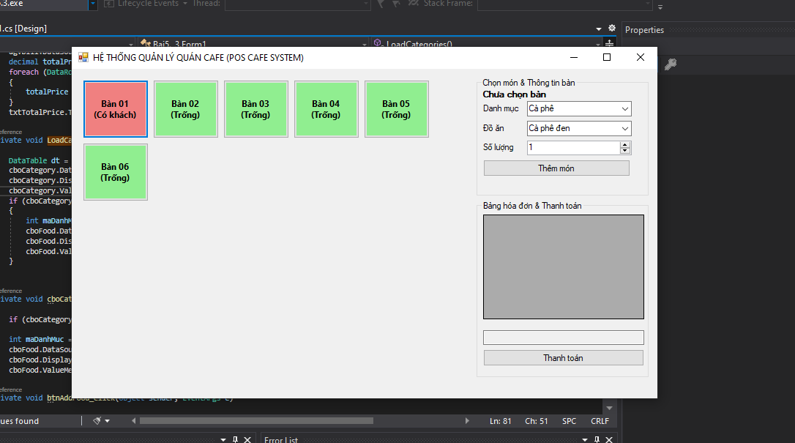

2. **Màn hình Quản lý Danh mục / Chọn món:**
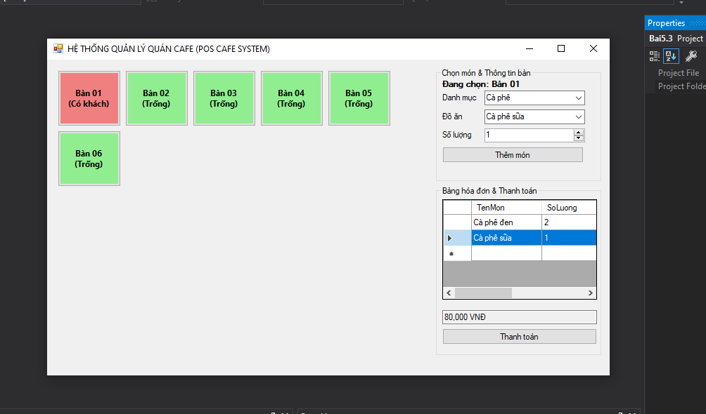

3. **Màn hình Thực thi Nghiệp vụ Gọi món (Chuyển bàn Có khách):**
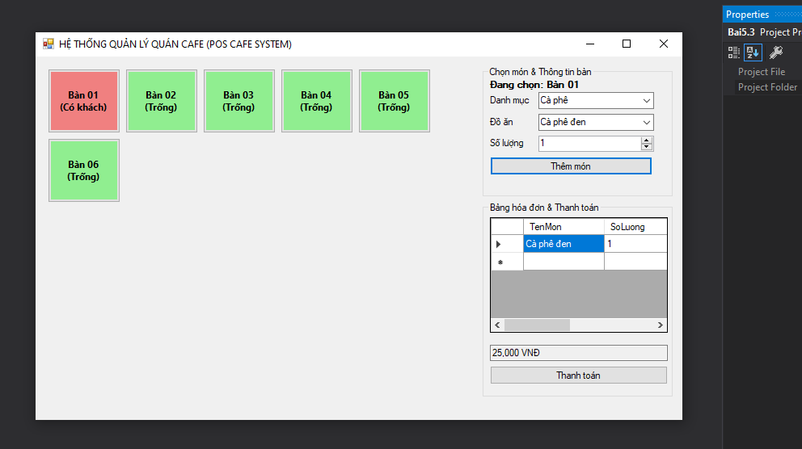

4. **Màn hình Báo cáo - Thống kê Hóa đơn tạm:**
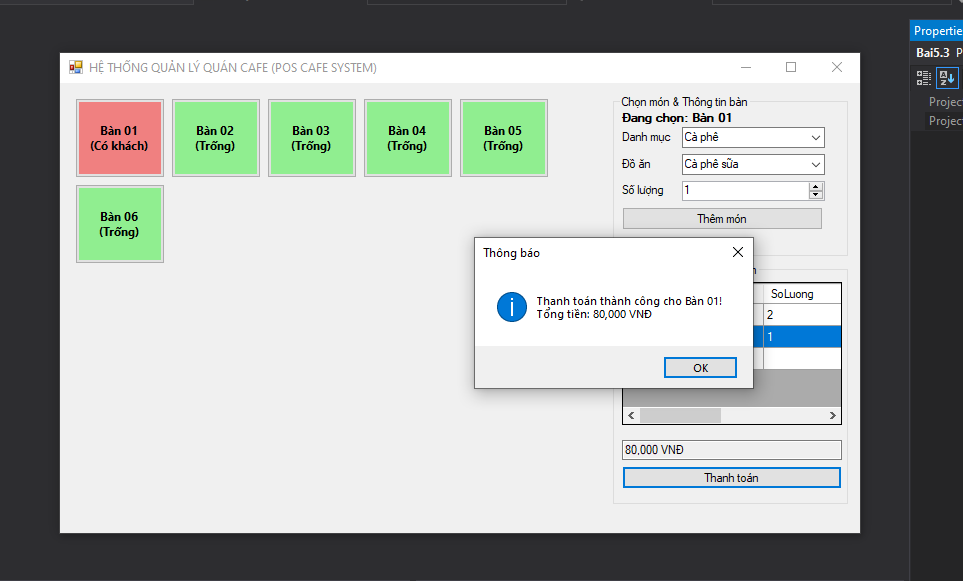

5. **Minh họa Thanh toán thành công (Thực thi SqlTransaction):**
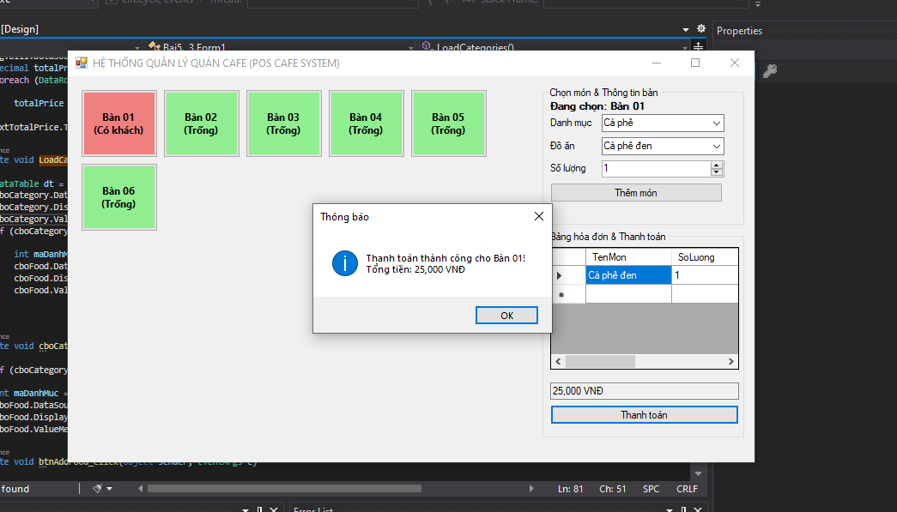

---

### II. BÀI TẬP 5.4: HỆ THỐNG QUẢN LÝ KHÁCH SẠN (HOTEL MANAGEMENT SYSTEM)

1. **Màn hình Chính / Tổng quan Quản lý Phòng:**
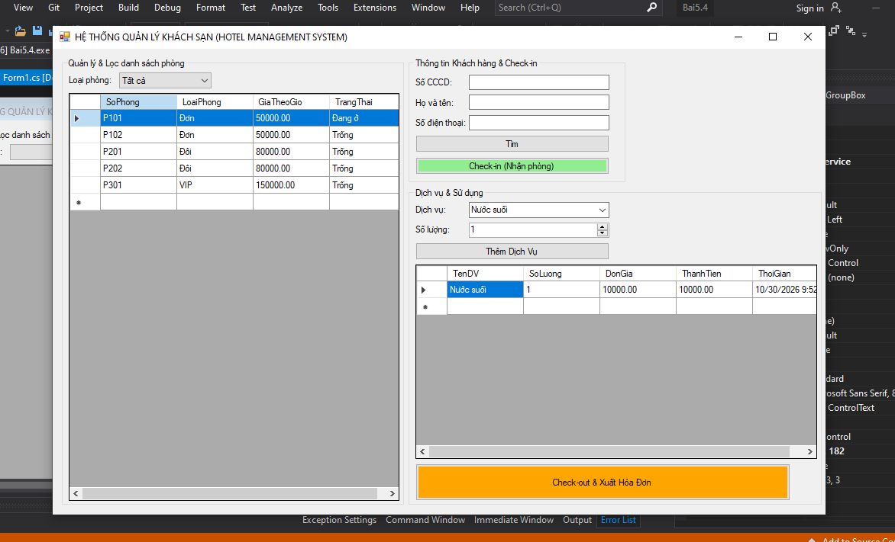

2. **Màn hình Tra cứu Khách hàng theo CCCD (SqlParameter):**
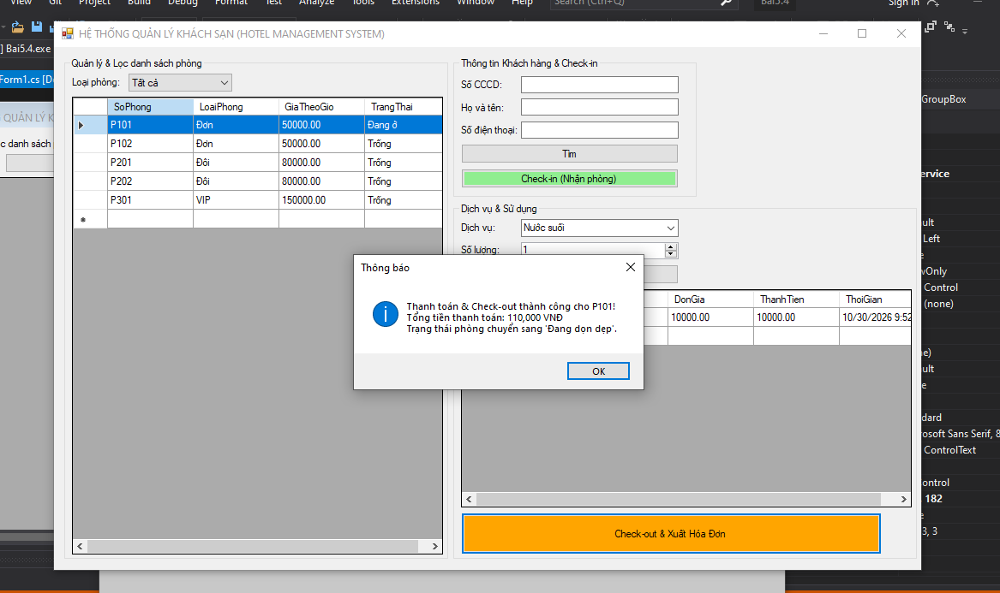

3. **Màn hình Thực thi Nghiệp vụ Check-in & Gọi Dịch vụ:**
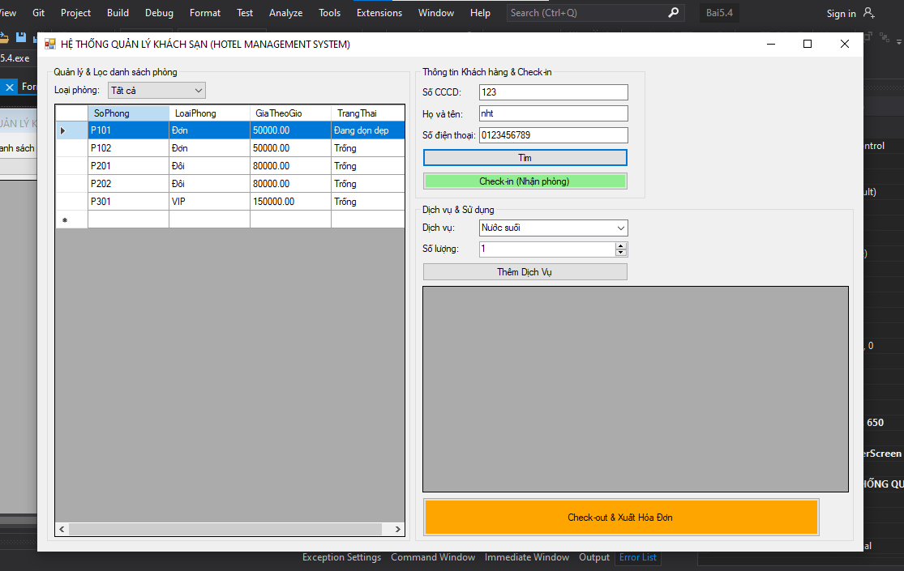

4. **Màn hình Lọc phòng ngắt kết nối (DataView) & Thống kê Dịch vụ:**
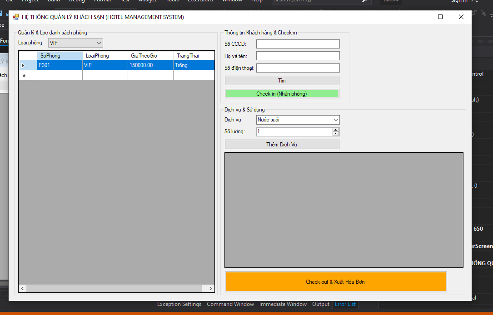

---

### III. BÀI TẬP 5.5: HỆ THỐNG QUẢN LÝ XUẤT - NHẬP KHO (INVENTORY MANAGEMENT)

1. **Màn hình Chính / Tổng quan Danh mục Vật tư & Tồn kho:**
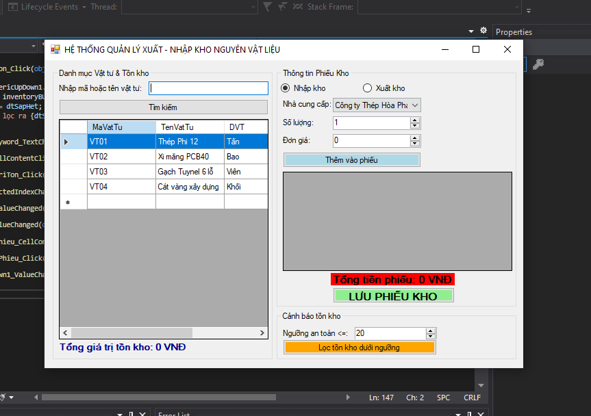

2. **Màn hình Tra cứu Vật tư chống SQL Injection (SqlParameter):**

3. **Màn hình Lập Phiếu Kho (Nhập / Xuất kho):**
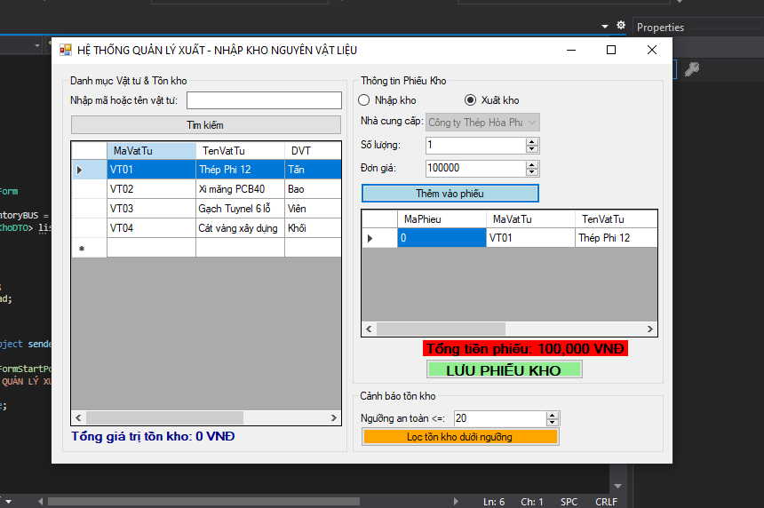

4. **Màn hình Thống kê Tổng giá trị tồn kho & Cảnh báo tồn kho:**
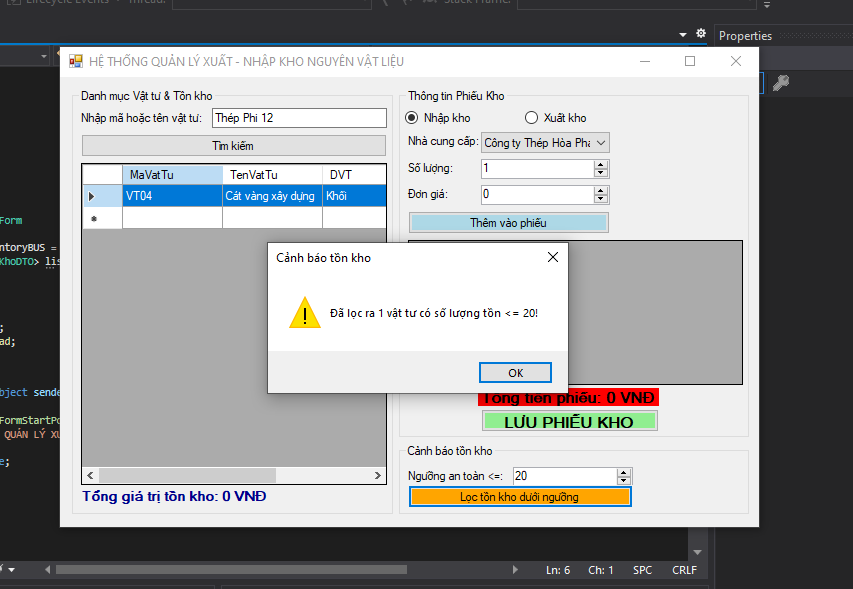
